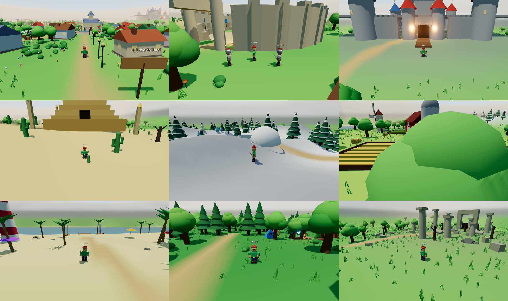

# Arena das Moedas — mundo aberto 3D

Jogo de mundo aberto no navegador (Three.js) com **avatar estilo Roblox**, **8 regiões**, **modo carreira**,
**duelos PvP**, **jogadores online** e uma economia própria (loja, mercado, trocas, torneios).
A moeda é **interna do jogo** e não vale dinheiro.



## Como jogar

```
cd arena-game
npm install          # three e ws
npm start            # http://127.0.0.1:8800
HOST=0.0.0.0 npm start   # amigos na mesma rede entram por http://SEU-IP:8800
npm test             # 28 testes (economia, mundo, combate e integração por WebSocket)
```

Abra duas abas (ou dois computadores) com nomes diferentes para ver o online funcionando.
Computador com placa de vídeo recomendado: o mundo tem ~700 mil triângulos. A tecla **P** alterna o modo desempenho
(e o jogo cai sozinho para ele se ficar lento).

## Controles

**WASD** mover · **Espaço** pular · **Shift** correr · clique ou **F** atacar · **E** falar com NPC ·
botão direito + arrastar (ou setas) gira a câmera · roda do mouse: zoom · **Tab** mapa grande · **Enter** chat ·
**1–5** habilidades · painéis: **B** Loja · **I** Inventário · **K** Habilidades · **M** Mercado · **T** Troca ·
**O** Torneios · **C** Carreira · **V** Batalha · **U** Avatar · **H** Ajuda.

## O que tem

| Recurso | Detalhes |
|---|---|
| Avatar | Bonequinho de blocos arredondados com rosto, 5 cabelos, 6 peles, 10 camisas, 8 calças e 4 rostos (tecla **U**). Equipamentos aparecem no corpo: chapéus, elmos, coroas, armaduras, capas, asas, mochila, armas e ferramentas. |
| Mundo | 640×640 com Vila Moeda (praça, fonte, prefeitura com relógio, feira, ferraria), Coliseu, Floresta Sussurrante, Deserto com pirâmide e oásis, Montanhas Geladas com iglus, Fazenda com moinho, Praia com farol e doca, Ruínas e o Castelo do Rei Gosma. Estradas, lagos, mar, **dia e noite** (12 min), nuvens, estrelas, vento na grama. |
| Online | Veja outros jogadores em tempo real (posição, nome, equipamento), balões de chat e chat global. |
| Carreira (**C**) | 7 capítulos em ordem: falar com o Prefeito → 8 Gosmas → 5 cristais na floresta → 8 Escorpiões → 8 Lobos → 6 Esqueletos → **Rei Gosma**. Ao vencer, você "zera" o jogo, ganha a Coroa do Herói e um aviso no chat global. |
| Batalha (**V**) | Duelo 1×1 no Coliseu com aposta de 10 moedas (10% destruído). O servidor valida distância, intervalo dos golpes e calcula o dano com os atributos reais. Dura 90 s; vence quem derrubar o outro ou tiver mais vida. |
| Economia | Loja, evolução de habilidades, mercado entre jogadores (taxa de 5% destruída), troca direta atômica e torneios simulados. |
| Monstros | Gosma, Bruto, Escorpião, Lobo, Esqueleto e o chefe Rei Gosma. Mais longe da vila = mais fortes. A vila é zona segura. |

## Segurança: o que está garantido e o que não está

Garantido e testado (`npm test`):
- Toda compra, venda, troca, aposta e recompensa é validada no **servidor**.
- **Auditoria das moedas** (criadas = jogadores + custódia + destruídas) fecha a cada operação, inclusive no teste online que
  conecta dois jogadores por WebSocket, anda até o Coliseu e faz um duelo completo.
- **Anti-teleporte**: o servidor limita a velocidade e devolve a posição.
- **Bioma**: só vale derrotar um monstro estando na região dele; NPC e cristal exigem estar perto.
- Chat com limite de frequência/tamanho; excesso de mensagens recebe resposta "devagar" (não é descartado em silêncio).
- Duelo: dano calculado só no servidor; aposta devolvida se o duelo for cancelado, empatar ou o servidor cair.

- **Combate no servidor**: monstros são do servidor e compartilhados. Ataques, habilidades, dano, vida, recompensas e morte são
  calculados lá (recarga, alcance e ângulo validados). O navegador só desenha; avisar "matei" não existe mais.
- **Cooperação**: quem causa dano e está perto na hora da morte recebe moedas e XP (teto de 450 moedas/hora por jogador).

**Limites conhecidos (importante):**
- Não há senha (o personagem é guardado por um token no navegador). Dados em um arquivo JSON (`data/game.json`).
- Em duelos só vale o ataque corpo a corpo (habilidades ficam desligadas).
- Ainda não há tela de créditos nem celular/controle (só teclado e mouse).

## Estrutura

```
server/   economy.js (regras e auditoria) · monsters.js (monstros e combate) · world.js (presença, chat, duelos) · index.js (rede) · catalog.js
public/   game.js (jogabilidade) · avatar.js (bonecos) · world.js + structures.js (mundo) · visuals.js (partículas/bloom)
          ui.js (painéis) · main.js (HUD) · minimap.js · shared/ (mapa e missões, lidos por servidor e cliente)
test/     economy · world · online (integração por WebSocket)
```

## Próximos passos sugeridos

1. Chefes com fases, dungeons e mais missões; tela de créditos e "novo jogo+".
2. Duelos 2×2 e torneios com PvP real; ranking.
3. Contas com senha e banco de dados (SQLite).
