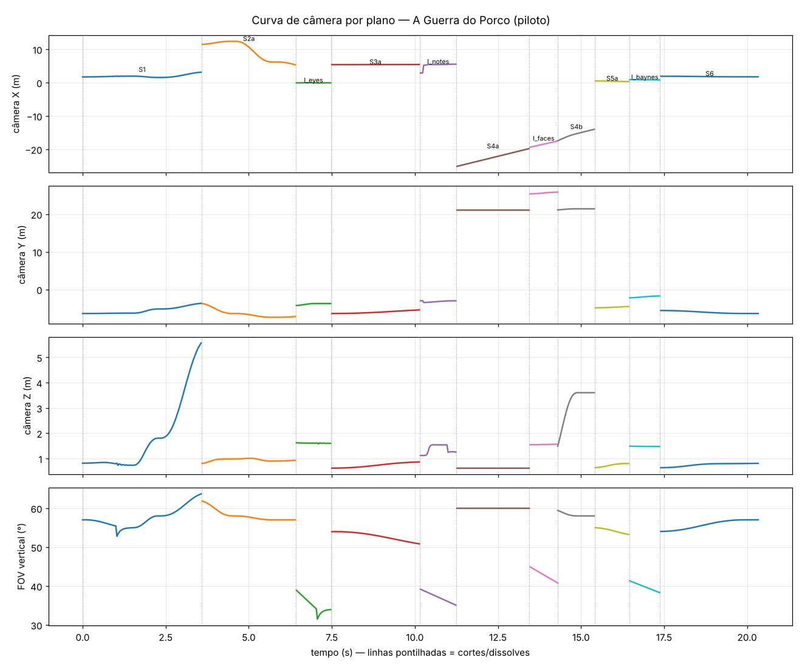
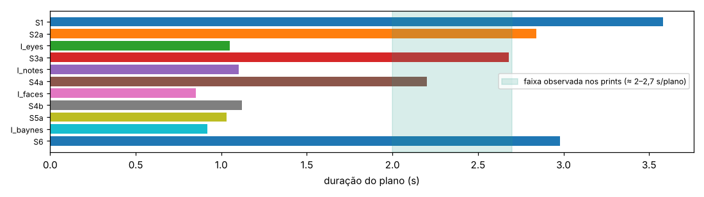

# Câmera e montagem — A Guerra do Porco (piloto)

11 planos · duração média 1.85 s (mín 0.85, máx 3.58) · 4.91 cortes por 10 s

| plano | cena | t (s) | dur | movimento de câmera (projeto) | vel. média (m/s) | FOV ini→fim | sujeitos no quadro | x médio (0–1) |
|---|---|---|---:|---|---:|---|---:|---:|
| S1 | S1 | 0.00–3.58 | 3.58 | baixa, fov 57 → sobe e revela a frota | 1.86 | 57.0→63.6 | 50.0 % | 0.17 |
| S2a | S2 | 3.58–6.42 | 2.84 | tilt-up na bandeira → placa SAN JUAN 1859 → push-in na horta | 3.58 | 61.8→57.0 | 38.8 % | -0.36 |
| I_eyes | I_eyes | 6.42–7.47 | 1.05 | close frontal, empurra 1,75 → 1,2 m, tremor no tiro | 0.81 | 38.9→33.9 | 9.4 % | 0.84 |
| S3a | S3 | 7.47–10.15 | 2.68 | baixa, roll .13, push-in lento | 0.38 | 53.9→50.8 | 100.0 % | 0.45 |
| I_notes | I_notes | 10.15–11.25 | 1.1 | close baixo com dutch | 3.39 | 39.2→35.1 | 0.0 % | 0.56 |
| S4a | S4 | 11.25–13.45 | 2.2 | baixa, acompanha a marcha | 2.45 | 60.0→60.0 | 100.0 % | None |
| I_faces | I_faces | 13.45–14.30 | 0.85 | close lateral acompanhando | 2.32 | 44.9→40.8 | 0.0 % | None |
| S4b | S4 | 14.30–15.43 | 1.12 | sobe e panorâmica sobre a tropa até a frota | 3.96 | 59.4→58.0 | 100.0 % | None |
| S5a | S5 | 15.43–16.46 | 1.03 | baixa, roll -.1 | 0.43 | 55.0→53.2 | 100.0 % | 0.52 |
| I_baynes | I_baynes | 16.46–17.38 | 0.92 | close baixo, push-in | 0.54 | 41.3→38.3 | 0.0 % | -0.4 |
| S6 | S6 | 17.38–20.36 | 2.98 | pull-back até o enquadramento do quadro 0 (loop) | 0.29 | 54.0→57.0 | 100.0 % | 0.5 |

